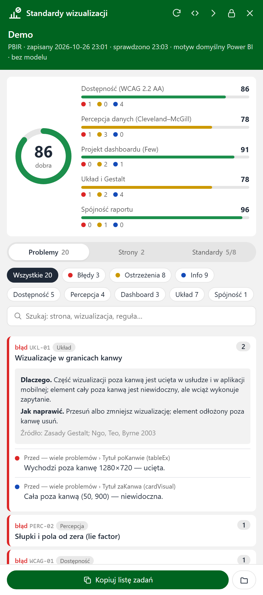

# Standardy wizualizacji

**Narzędzie zewnętrzne Power BI Desktop: kontrola raportu według standardów wizualizacji, które sam wybierasz.**


> *English summary:* a Power BI Desktop external tool that docks a panel to the Power BI window and checks the open
> report (PBIR, PBIR-legacy or .pbix) against selectable visualization standards — WCAG 2.2 AA, Cleveland–McGill
> graphical perception, IBCS, Tufte's data-ink, Few's dashboard design, Gestalt layout, report consistency and
> Microsoft's Power BI guidance. 55 rules, per-standard scores, read-only. UI and rule texts are in Polish.



Przycisk na wstążce **Narzędzia zewnętrzne** otwiera panel przyklejony do prawej krawędzi okna Power BI. Panel
sprawdza otwarty raport i pokazuje:

- ocenę 0–100 dla każdego wybranego standardu,
- listę problemów z wyjaśnieniem „dlaczego” i „jak naprawić”,
- szkice stron z zaznaczonymi wizualizacjami, które mają uwagi,
- listę zadań do skopiowania (Markdown), np. do asystenta AI albo do zgłoszenia.

**Narzędzie tylko czyta** — niczego nie zmienia w raporcie ani w modelu.

## Co sprawdza

| Standard | Co sprawdza |
|---|---|
| **Dostępność (WCAG 2.2 AA)** | kontrast tekstu i grafiki, kolory rozróżnialne przy daltonizmie (symulacja), tekst alternatywny, rozmiar pisma, kolejność tabulacji, nazwy i tytuły |
| **Percepcja danych (Cleveland–McGill)** | kanał kodowania (pozycja zamiast kąta i pola), słupki od zera, druga oś, liczba serii, rozróżnialność kolorów (ΔE2000), hierarchia pisma |
| **IBCS** | właściwe typy wykresów, czas w poziomie, linie tylko dla czasu, scenariusze (rok poprzedni jaśniej), tytuł z komunikatem, kolor z sensem, sortowanie, jednolita skala |
| **Minimalizm danych (Tufte)** | ramy i cienie, siatka i oś obok etykiet danych, legenda przy jednej serii, nadmierna precyzja |
| **Projekt dashboardu (Few)** | liczba wizualizacji i fragmentatorów, mierniki, jeden ekran, liczby z kontekstem, liczba barw |
| **Układ i Gestalt** | kanwa, nakładanie, wyrównanie, rytm odstępów, równowaga, wypełnienie, KPI nad szczegółami |
| **Spójność raportu** | położenie fragmentatorów, kolor miary, rozmiary tytułów, rozmiar stron, kroje pisma |
| **Dobre praktyki Power BI (Microsoft)** | nazwy stron, liczba wizualizacji a wydajność, wizualizacje niestandardowe, ukryte i puste elementy, jawne miary, nowoczesne typy |

Wszystkie 55 reguł z uzasadnieniem, instrukcją naprawy i źródłami: **[Katalog reguł](docs/reguly.md)**.

Standardy i pojedyncze reguły włączasz w zakładce **Standardy**. Są też gotowe profile: **Podstawowy** (domyślny),
**Raport zarządczy (IBCS)**, **Dostępność** i **Wszystkie**. Zmiana wyboru działa od razu, bez ponownego
sprawdzania, i jest zapamiętywana.

## Szybki start

Potrzebujesz Windowsa z Power BI Desktop i Pythona 3.9+ (bez dodatkowych pakietów).

```powershell
# 1. pobierz do stałego folderu
git clone https://github.com/SzczepanGortowski/PowerBI-Ocena-Projektu.git C:\Narzedzia\standardy-wizualizacji
cd C:\Narzedzia\standardy-wizualizacji

# 2. opcjonalnie: zrzuty stron i wykrywanie niezapisanych zmian (wymaga Node.js)
npm install

# 3. rejestracja przycisku (okno UAC)
powershell -ExecutionPolicy Bypass -File .\instaluj.ps1
```

Uruchom ponownie Power BI Desktop, otwórz raport i kliknij **Narzędzia zewnętrzne → Standardy wizualizacji**.
Szczegóły, także instalacja bez uprawnień administratora: [Instalacja](docs/instalacja.md).

Silnik działa też bez Power BI, z wiersza poleceń:

```powershell
python standardy.py --raport przyklad\Demo.Report --profil wszystkie     # raport demonstracyjny z repozytorium
python standardy.py --raport "C:\raporty\Sprzedaz.pbip" --profil ibcs
```

## Dokumentacja

| Dokument | Zawartość |
|---|---|
| [Instalacja](docs/instalacja.md) | wymagania, instalacja, aktualizacja, odinstalowanie |
| [Użycie](docs/uzycie.md) | panel, wiersz poleceń, pliki wynikowe, raport demonstracyjny |
| [Katalog reguł](docs/reguly.md) | 55 reguł w 8 standardach: dlaczego, jak naprawić, źródła |
| [Ocena i konfiguracja](docs/ocena-i-konfiguracja.md) | jak liczy się ocena, wagi, profile, progi reguł |
| [Rozwiązywanie problemów](docs/rozwiazywanie-problemow.md) | komunikaty błędów, dziennik, ograniczenia |
| [Architektura](docs/architektura.md) | jak działa panel i silnik, format `wynik.json` |
| [Rozwijanie](docs/rozwijanie.md) | testy, nowa reguła, nowy standard |

## Jak to działa

Przycisk uruchamia `uruchom.ps1`, który otwiera panel (`okno.ps1`: WinForms + WebView2 z interfejsem z `app/`).
Panel w tle rozpoznaje plik otwarty w Power BI, opcjonalnie czyta definicję modelu przez TOM i uruchamia silnik
reguł w Pythonie (`standardy.py`, pakiet `standardy_wiz/`). Silnik czyta definicję raportu (PBIR, PBIR-legacy albo
`.pbix`) i zapisuje `wynik.json`, a panel go wyświetla. Biblioteki WebView2 i TOM pochodzą z zainstalowanego
Power BI Desktop. Więcej: [Architektura](docs/architektura.md).

## Ograniczenia

- Reguły czytają **definicję** raportu, nie obraz: nie widzą uciętych etykiet ani przewijanych tabel. Do tego służy
  przycisk **Pokaż prawdziwy wygląd** (zrzut strony z Desktopa).
- Raport jest czytany z pliku: przy niezapisanych zmianach zapisz (**Ctrl+S**) i sprawdź ponownie.
- Panel to osobne okno przyklejone do Power BI, bo Power BI Desktop nie ma API do paneli w swoim oknie.

Pełna lista: [Rozwiązywanie problemów](docs/rozwiazywanie-problemow.md#ograniczenia-które-nie-są-błędami).

## Licencja

MIT — zob. [LICENSE](LICENSE). Desktop Bridge CLI (opcjonalny, instalowany przez `npm install`) ma własną licencję
MIT (Microsoft).
