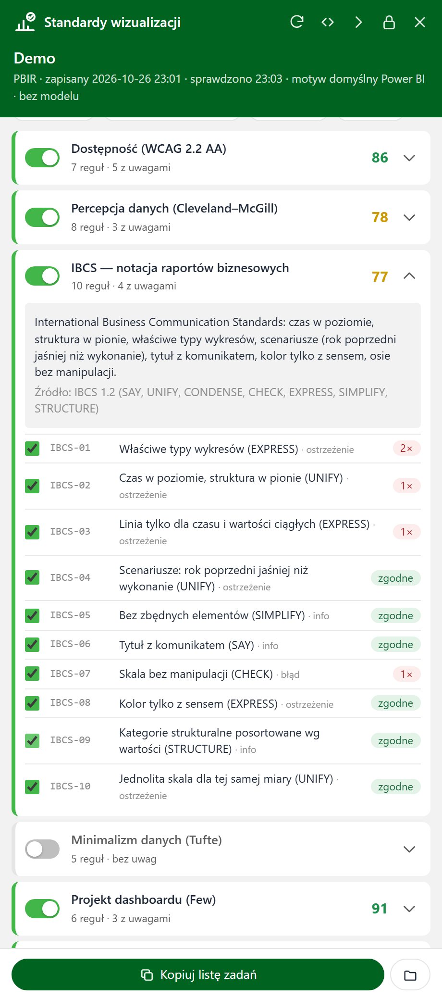

# Standardy wizualizacji

**Narzędzie zewnętrzne Power BI Desktop: kontrola raportu według standardów wizualizacji, które sam wybierasz.**

> *English summary:* a Power BI Desktop external tool that docks a panel to the Power BI window and checks the open
> report (PBIR, PBIR-legacy or .pbix) against selectable visualization standards — WCAG 2.2 AA, Cleveland–McGill
> graphical perception, IBCS, Tufte's data-ink, Few's dashboard design, Gestalt layout, report consistency and
> Microsoft's Power BI guidance. 55 rules, per-standard scores, read-only. UI and rule texts are in Polish.


Przycisk na wstążce **Narzędzia zewnętrzne** otwiera panel przyklejony do prawej krawędzi okna Power BI. Panel
sprawdza otwarty raport i pokazuje ocenę 0–100 dla każdego wybranego standardu, listę problemów z wyjaśnieniem
„dlaczego” i „jak naprawić” oraz szkice stron z zaznaczonymi wizualizacjami. **Narzędzie tylko czyta** — niczego
nie zmienia w raporcie ani w modelu.

| Standard | Co sprawdza |
|---|---|
| **Dostępność (WCAG 2.2 AA)** | kontrast tekstu i grafiki, kolory rozróżnialne przy daltonizmie (symulacja), tekst alternatywny, rozmiar pisma, kolejność tabulacji, nazwy i tytuły |
| **Percepcja danych (Cleveland–McGill)** | kanał kodowania (pozycja zamiast kąta i pola), słupki od zera, druga oś, liczba serii, rozróżnialność kolorów (ΔE2000), hierarchia pisma |
| **IBCS** | właściwe typy wykresów, czas w poziomie, linie tylko dla czasu, scenariusze (rok poprzedni jaśniej), tytuł z komunikatem, kolor z sensem, sortowanie, jednolita skala |
| **Minimalizm danych (Tufte)** | ramy i cienie, siatka i oś obok etykiet danych, legenda przy jednej serii, nadmierna precyzja |
| **Projekt dashboardu (Few)** | liczba wizualizacji i fragmentatorów, mierniki, jeden ekran, liczby z kontekstem, liczba barw |
| **Układ i Gestalt** | kanwa, nakładanie, wyrównanie, rytm odstępów, równowaga, wypełnienie, KPI nad szczegółami |
| **Spójność raportu** | położenie fragmentatorów, kolor miary, rozmiary tytułów, rozmiar stron, kroje pisma |
| **Dobre praktyki Power BI (Microsoft)** | nazwy stron, liczba wizualizacji a wydajność, wizualizacje niestandardowe, ukryte i puste elementy, jawne miary, nowoczesne typy |

## Wybór standardów



W zakładce **Standardy** włączasz i wyłączasz całe standardy, a po rozwinięciu standardu — pojedyncze reguły.
Gotowe profile: **Podstawowy** (dostępność, percepcja, układ, spójność, dashboard — domyślny), **Raport zarządczy
(IBCS)**, **Dostępność**, **Wszystkie**. Zmiana wyboru działa od razu (ocena przelicza się bez ponownego
sprawdzania) i jest zapamiętywana dla kolejnych raportów.

## Wymagania

- Windows i Power BI Desktop (wersja ze Sklepu Microsoft albo instalator MSI).
- Python 3.9+ — silnik używa wyłącznie biblioteki standardowej (bez `pip install`). Narzędzie szuka kolejno:
  `.venv` w swoim folderze (albo w folderach nadrzędnych), `py -3`, `python`.
- Opcjonalnie Node.js + `npm install` w folderze narzędzia ([Desktop Bridge CLI](https://www.npmjs.com/package/@microsoft/powerbi-desktop-bridge-cli),
  public preview): pewne rozpoznanie pliku otwartego w oknie Desktopa, ostrzeżenie o niezapisanych zmianach i zrzuty
  stron („Pokaż prawdziwy wygląd”). Bez niego plik jest rozpoznawany z linii poleceń i listy ostatnich plików Desktopa.

Biblioteki WebView2 (interfejs panelu) i TOM (odczyt modelu) narzędzie bierze z folderu zainstalowanego Power BI Desktop.

## Instalacja

```powershell
# 1. pobierz repozytorium (albo rozpakuj zip) do stałego folderu, np. C:\Narzedzia\standardy-wizualizacji
# 2. opcjonalnie: bridge do zrzutów stron
npm install
# 3. rejestracja przycisku (folder narzędzi zewnętrznych Power BI wymaga zgody administratora — okno UAC)
powershell -ExecutionPolicy Bypass -File .\instaluj.ps1
```

Po instalacji **uruchom ponownie Power BI Desktop** — przycisk **Standardy wizualizacji** pojawi się na wstążce
**Narzędzia zewnętrzne**. Rejestracja (`%CommonProgramFiles(x86)%\Microsoft Shared\Power BI Desktop\External Tools\Standardy wizualizacji.pbitool.json`)
wskazuje na `uruchom.ps1` w tym folderze: zmiany w narzędziu nie wymagają ponownej instalacji, przeniesienie folderu —
tak. `instaluj.ps1 -TylkoPlik` zapisuje plik rejestracji obok (do przekazania administratorowi), `-Odinstaluj` usuwa rejestrację.

## Użycie

1. Otwórz raport w Power BI Desktop i kliknij **Narzędzia zewnętrzne → Standardy wizualizacji**. Panel rozpoznaje
   plik, czyta definicję raportu i — gdy model jest lokalny — typy kolumn z modelu (lepsze rozpoznanie osi czasu).
2. **Problemy** — klik w standard na liście ocen filtruje jego problemy; filtry wag i standardów, szukanie; rozwinięcie
   reguły = dlaczego, jak naprawić, źródło, wystąpienia.
3. **Strony** — szkic każdej strony z obrysem wizualizacji z uwagami; klik w prostokąt = uwagi do wizualizacji;
   **Pokaż prawdziwy wygląd** = zrzut strony z Desktopa (wymaga bridge'a).
4. **Kopiuj listę zadań** — problemy z wybranych standardów z instrukcją naprawy (Markdown), np. do wklejenia
   w asystenta AI albo do zgłoszenia.

Przyciski u góry: **⟳** sprawdź ponownie (też F5 albo ponowne kliknięcie na wstążce), **szerzej/węziej**,
**zwiń do paska**, **odepnij** (zwykłe okno), **zamknij**. Raport jest czytany z pliku — przy niezapisanych zmianach
panel to pokazuje: zapisz (**Ctrl+S**) i kliknij ⟳.

### Bez Power BI — z wiersza poleceń

```powershell
python standardy.py --lista                                                  # standardy, profile, reguły
python standardy.py --raport przyklad\Demo.Report --profil wszystkie         # raport demonstracyjny z repozytorium
python standardy.py --raport "C:\...\Raport.pbip" --standardy wcag,uklad --wylaczone WCAG-04
python standardy.py --raport "C:\...\Raport.pbix" --profil ibcs
powershell -File .\analiza.ps1 -DesktopPid <pid>                             # raport + model z działającego Desktopa
```

Wynik: `%TEMP%\StandardyWizualizacji\<raport>\wynik.json` (wszystkie reguły) i `zadania.md` (wybrane standardy).
Dziennik i ustawienia panelu: `%LOCALAPPDATA%\StandardyWizualizacji\` (`okno.log`, `ustawienia.json`).

## Konfiguracja i ocena

`konfiguracja.json` — progi reguł (`tekst_min_pt`, `wizualizacje_max`, `wizualizacje_blad`, `wizualizacje_wydajnosc`,
`tolerancja_px`, `pozycja_tolerancja_px`).

**Ocena:** każdy standard startuje od 100; każda naruszona reguła odejmuje wagę × (1 + log₂ liczby wystąpień),
najwyżej 3× wagę (błąd 10, ostrzeżenie 4, info 1). Ocena ogólna to średnia wybranych standardów. Wyłączona reguła
nie liczy się do oceny i znika z listy problemów.

## Ograniczenia

- Reguły czytają **definicję** raportu, nie obraz: nie widzą uciętych etykiet, przewijanych tabel ani pustych
  wizualizacji — do tego służy „Pokaż prawdziwy wygląd”.
- Liczby kategorii nie ma w definicji — przy roli Series/Legend kolory serii są brane z palety motywu dla 6
  kategorii (waga obniżona do info, opis to zaznacza).
- Oś czasu i kategorie ciągłe/porządkowe: z typów kolumn modelu (gdy dostępny), inaczej z nazw pól.
- Kolory z formatowania warunkowego są pomijane; kontrast liczony tylko tam, gdzie tło jest znane z definicji
  (nie nad obrazem tła strony).
- Strony podpowiedzi (mała kanwa albo ukryta strona typu Tooltip) są pomijane.
- Power BI Desktop nie ma API na panele w swoim oknie — panel to osobne okno przyklejone do Power BI (zasłania prawe
  okienka; zwiń go do paska albo odepnij).

## Jak to działa

```
uruchom.ps1                 starter z przycisku (rejestracja .pbitool.json) → odpala okno.ps1 ukryte
okno.ps1                    panel: WinForms + WebView2 przyklejony do okna Power BI, analiza w tle, zrzuty, ustawienia
natywne.cs                  P/Invoke (DPI, właściciel okna, przeciąganie), okno bez ramki z cieniem
analiza.ps1                 plik raportu (bridge / linia poleceń / ostatnie pliki), definicja modelu przez TOM, silnik
wspolne.ps1                 wspólne funkcje (instancja Desktopa, bridge, Python)
instaluj.ps1                rejestracja przycisku
app/                        interfejs panelu (HTML/CSS/JS, ikony)
standardy.py                punkt wejścia silnika (Python, biblioteka standardowa)
standardy_wiz/
  katalog.py                standardy, profile, rejestr reguł (@regula), ocena
  kontekst.py               scalony motyw, teksty, tło, kolory serii, oś czasu, obszar roboczy
  kolor.py                  kontrast WCAG, CIELAB, CIEDE2000, symulacja daltonizmu (Machado 2009)
  reguly_<standard>.py      reguły: wcag, percepcja, ibcs, minimalizm, dashboard, uklad, spojnosc, microsoft
  silnik.py                 uruchomienie reguł, wynik.json, szkice stron, lista zadań
  pbi/                      odczyt raportu (PBIR, PBIR-legacy, .pbix), modelu (TMSL) i kaskady formatowania
przyklad/Demo.Report        syntetyczny raport demonstracyjny (strona „Przed” z naruszeniami, „Po” — czysta)
testy/test_standardy.py     testy reguł, wyboru standardów i kolorymetrii
```

Panel i okno-gospodarz rozmawiają przez WebView2 (`PostWebMessageAsJson` / `chrome.webview.postMessage`). Silnik
zawsze sprawdza wszystkie reguły; wybór standardów i ocena dla bieżącego wyboru liczą się w przeglądarce (`app.js`).

**Nowa reguła** = funkcja z dekoratorem `@regula(id, standard, waga, tytuł, dlaczego, jak, źródło)` w pliku
`reguly_<standard>.py`, zwracająca znaleziska przez `ctx.problem_wiz` / `problem_str` / `problem_rap`, + przypadek
w teście. **Nowy standard** = `_standard(...)` w `katalog.py`, nowy plik reguł zaimportowany w `silnik.py`,
opcjonalnie wpis w `PROFILE`.

```powershell
python -m unittest discover -s testy -v
```

Pułapki PowerShell 5.1, o które łatwo się potknąć przy zmianach: pliki `.ps1` muszą być w **UTF-8 z BOM**; polski
cudzysłów w napisie działa jak ogranicznik; pusty argument `""` z linii poleceń znika (dlatego `uruchom.ps1` sam
parsuje `$args`). Python ze Sklepu Microsoft wirtualizuje zapisy do `%LOCALAPPDATA%`, więc wymiana plików między
silnikiem a panelem idzie przez `%TEMP%`.

## Licencja

MIT — zob. [LICENSE](LICENSE). Desktop Bridge CLI (opcjonalny, instalowany przez `npm install`) ma własną licencję MIT (Microsoft).

## Reguły

### Dostępność (WCAG 2.2 AA) `wcag`

Czy raport odczyta osoba słabowidząca, z zaburzeniami widzenia barw albo z czytnikiem ekranu: kontrast tekstu i grafiki, kolory rozróżnialne przy daltonizmie, tekst alternatywny, kolejność tabulacji, rozmiar pisma. Źródła: W3C WCAG 2.2 (SC 1.1.1, 1.4.1, 1.4.3, 1.4.11, 2.4.3, 2.4.6); Microsoft: Design Power BI reports for accessibility.

| Reguła | Co sprawdza | Waga |
|---|---|---|
| `WCAG-01` | Kontrast tekstu (SC 1.4.3) | ostrzeżenie |
| `WCAG-02` | Kontrast elementów graficznych (SC 1.4.11) | ostrzeżenie |
| `WCAG-03` | Kolory serii rozróżnialne przy daltonizmie (SC 1.4.1) | ostrzeżenie |
| `WCAG-04` | Tekst alternatywny (SC 1.1.1) | info |
| `WCAG-05` | Minimalny rozmiar tekstu | ostrzeżenie |
| `WCAG-06` | Kolejność tabulacji (SC 2.4.3) | info |
| `WCAG-07` | Nazwy stron i tytuły wizualizacji (SC 2.4.6) | info |

### Percepcja danych (Cleveland–McGill) `percepcja`

Czy wykres koduje liczby kanałem, który oko odczytuje dokładnie (pozycja i długość zamiast kąta i pola), czy skala nie przekłamuje, czy kolory serii da się rozróżnić i czy hierarchia pisma jest czytelna. Źródła: Cleveland i McGill 1984; Heer i Bostock 2010; Tufte 1983 (lie factor); Szafir 2018 (ΔE00).

| Reguła | Co sprawdza | Waga |
|---|---|---|
| `PERC-01` | Skuteczny kanał kodowania | info |
| `PERC-02` | Słupki i pola od zera (lie factor) | błąd |
| `PERC-03` | Bez drugiej osi wartości | ostrzeżenie |
| `PERC-04` | Najwyżej 4 miary na wykresie | ostrzeżenie |
| `PERC-05` | Kolory serii łatwe do rozróżnienia | ostrzeżenie |
| `PERC-06` | Czytelna hierarchia pisma | info |
| `PERC-07` | Najwyżej 2 kroje pisma na stronie | ostrzeżenie |
| `PERC-08` | Ta sama miara w tym samym kolorze | ostrzeżenie |

### IBCS — notacja raportów biznesowych `ibcs`

International Business Communication Standards: czas w poziomie, struktura w pionie, właściwe typy wykresów, scenariusze (rok poprzedni jaśniej niż wykonanie), tytuł z komunikatem, kolor tylko z sensem, osie bez manipulacji. Źródła: IBCS 1.2 (SAY, UNIFY, CONDENSE, CHECK, EXPRESS, SIMPLIFY, STRUCTURE).

| Reguła | Co sprawdza | Waga |
|---|---|---|
| `IBCS-01` | Właściwe typy wykresów (EXPRESS) | ostrzeżenie |
| `IBCS-02` | Czas w poziomie, struktura w pionie (UNIFY) | ostrzeżenie |
| `IBCS-03` | Linia tylko dla czasu i wartości ciągłych (EXPRESS) | ostrzeżenie |
| `IBCS-04` | Scenariusze: rok poprzedni jaśniej niż wykonanie (UNIFY) | ostrzeżenie |
| `IBCS-05` | Bez zbędnych elementów (SIMPLIFY) | info |
| `IBCS-06` | Tytuł z komunikatem (SAY) | info |
| `IBCS-07` | Skala bez manipulacji (CHECK) | błąd |
| `IBCS-08` | Kolor tylko z sensem (EXPRESS) | ostrzeżenie |
| `IBCS-09` | Kategorie strukturalne posortowane wg wartości (STRUCTURE) | info |
| `IBCS-10` | Jednolita skala dla tej samej miary (UNIFY) | ostrzeżenie |

### Minimalizm danych (Tufte) `minimalizm`

Mniej „atramentu” poza danymi: bez ram i cieni, bez siatki i osi dublujących etykiety danych, bez legendy przy jednej serii, bez nadmiernej precyzji. Źródła: Tufte 1983: The Visual Display of Quantitative Information (data-ink ratio, chartjunk).

| Reguła | Co sprawdza | Waga |
|---|---|---|
| `TUF-01` | Bez ram i cieni wokół wizualizacji | info |
| `TUF-02` | Bez siatki przy etykietach danych | info |
| `TUF-03` | Oś wartości albo etykiety danych — nie oba | info |
| `TUF-04` | Legenda tylko przy kilku seriach | info |
| `TUF-05` | Bez nadmiernej precyzji etykiet | info |

### Projekt dashboardu (Few) `dashboard`

Strona ogarnięta jednym spojrzeniem: ograniczona liczba wizualizacji i fragmentatorów, bez mierników, liczby z kontekstem (cel, rok poprzedni), mieści się na jednym ekranie. Źródła: Few 2006: Information Dashboard Design; Miller 1956, Cowan 2001 (pamięć robocza).

| Reguła | Co sprawdza | Waga |
|---|---|---|
| `FEW-01` | Najwyżej 8 wizualizacji danych na stronie | ostrzeżenie |
| `FEW-02` | Najwyżej 4 fragmentatory na stronie | info |
| `FEW-03` | Bez mierników (gauge) | ostrzeżenie |
| `FEW-04` | Strona mieści się na jednym ekranie | info |
| `FEW-05` | Liczby z kontekstem | info |
| `FEW-06` | Ograniczona liczba kolorów na stronie | info |

### Układ i Gestalt `uklad`

Porządek na stronie: nic poza kanwą i nic na sobie, wyrównane krawędzie, rytm odstępów, równowaga, wykorzystany obszar, KPI nad szczegółami. Źródła: Zasady Gestalt (bliskość, wyrównanie); Ngo, Teo, Byrne 2003 (miary estetyki interfejsu).

| Reguła | Co sprawdza | Waga |
|---|---|---|
| `UKL-01` | Wizualizacje w granicach kanwy | błąd |
| `UKL-02` | Wizualizacje nie nachodzą na siebie | ostrzeżenie |
| `UKL-03` | Krawędzie wyrównane | info |
| `UKL-04` | Rytm odstępów | info |
| `UKL-05` | Równowaga strony | info |
| `UKL-06` | Wykorzystany obszar roboczy | info |
| `UKL-07` | KPI nad szczegółami | info |

### Spójność raportu `spojnosc`

Te same rzeczy wyglądają tak samo na każdej stronie: położenie fragmentatorów, kolor miary, rozmiary tytułów, kroje pisma, rozmiar stron. Źródła: Zasada spójności (IBCS UNIFY, Few 2006).

| Reguła | Co sprawdza | Waga |
|---|---|---|
| `SPJ-01` | Fragmentatory w tym samym miejscu na każdej stronie | ostrzeżenie |
| `SPJ-02` | Jedna miara = jeden kolor w całym raporcie | ostrzeżenie |
| `SPJ-03` | Jeden rozmiar tytułów wizualizacji | info |
| `SPJ-04` | Jednakowy rozmiar stron | info |
| `SPJ-05` | Najwyżej 2 kroje pisma w raporcie | info |

### Dobre praktyki Power BI (Microsoft) `microsoft`

Higiena raportu według wskazówek Microsoft: nazwy stron, liczba wizualizacji a wydajność, jawne miary, nowoczesne typy wizualizacji, wizualizacje niestandardowe, ukryte i puste elementy. Źródła: Microsoft Learn: Power BI report design tips; Optimization guide for Power BI.

| Reguła | Co sprawdza | Waga |
|---|---|---|
| `MS-01` | Nazwy stron opisują treść | ostrzeżenie |
| `MS-02` | Liczba wizualizacji a wydajność | ostrzeżenie |
| `MS-03` | Wizualizacje niestandardowe | info |
| `MS-04` | Ukryte wizualizacje | info |
| `MS-05` | Jawne miary zamiast agregacji kolumn | ostrzeżenie |
| `MS-06` | Strony z treścią | ostrzeżenie |
| `MS-07` | Nowoczesne typy wizualizacji | info |
