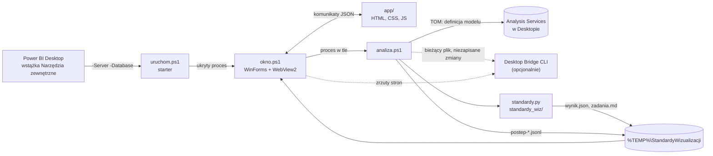

# Architektura

Narzędzie ma trzy warstwy: **gospodarza** w PowerShell (okno przyklejone do Power BI), **interfejs** w HTML/JS
(wyświetlany przez WebView2) i **silnik reguł** w Pythonie (biblioteka standardowa). Silnik niczego nie wie o
Power BI Desktop: dostaje ścieżkę do raportu i opcjonalnie definicję modelu, a zwraca `wynik.json`.



## Pliki

```
uruchom.ps1                 starter z przycisku (rejestracja .pbitool.json) → odpala okno.ps1 ukryte
okno.ps1                    panel: WinForms + WebView2 przyklejony do okna Power BI, analiza w tle, zrzuty, ustawienia
natywne.cs                  P/Invoke (DPI, właściciel okna, przeciąganie), okno bez ramki z cieniem
analiza.ps1                 plik raportu (bridge / linia poleceń / ostatnie pliki), definicja modelu przez TOM, silnik
wspolne.ps1                 wspólne funkcje (instancja Desktopa, bridge, Python)
instaluj.ps1                rejestracja przycisku
ikona.png                   ikona przycisku na wstążce i okna panelu
konfiguracja.json           progi reguł
app/                        interfejs panelu (index.html, app.css, app.js, ikony w app/ikony)
standardy.py                punkt wejścia silnika
standardy_wiz/
  __main__.py               opcje wiersza poleceń, zapis wynik.json i zadania.md
  katalog.py                standardy, profile, rejestr reguł (@regula), ocena
  kontekst.py               scalony motyw, teksty, tło, kolory serii, oś czasu, obszar roboczy — API dla reguł
  kolor.py                  kontrast WCAG, CIELAB, CIEDE2000, symulacja daltonizmu (Machado 2009)
  reguly_<standard>.py      reguły: wcag, percepcja, ibcs, minimalizm, dashboard, uklad, spojnosc, microsoft
  silnik.py                 uruchomienie reguł, oceny, szkice stron, lista zadań
  pbi/
    raport.py               odczyt raportu: PBIR, PBIR-legacy, .pbix → Raport › Strona › Wizualizacja
    kaskada.py              kaskada formatowania (motyw → style wizualizacji → obiekty wizualizacji)
    model.py, dax.py        model z TMSL (typy kolumn), lekki tokenizer DAX
przyklad/Demo.Report        syntetyczny raport demonstracyjny
testy/test_standardy.py     testy reguł, wyboru standardów, kolorymetrii i aktualności dokumentacji
docs/                       dokumentacja; generuj_reguly.py tworzy docs/reguly.md
```

## Przebieg jednego sprawdzenia

1. **Przycisk.** Power BI Desktop uruchamia `powershell.exe -File uruchom.ps1 -Server "localhost:<port>" -Database "<id>"`.
   Starter sam parsuje `$args`, bo PowerShell 5.1 gubi pusty argument `""` (raport z połączeniem na żywo albo
   kliknięcie w trakcie wczytywania pliku). Rozpoznaje proces `PBIDesktop.exe`, z którego go wywołano, odpala
   `okno.ps1` jako ukryty proces i od razu się kończy.
2. **Jeden panel na okno.** `okno.ps1` zakłada muteks `Local\StandardyWizualizacji-<pid Desktopa>`. Jeśli panel dla
   tego okna już działa, nowy proces zapisuje plik `sygnal-<pid>.txt` i kończy się, a działający panel podejmuje
   sygnał i sprawdza raport ponownie.
3. **Okno.** Biblioteki WebView2 są kopiowane z folderu `bin` Power BI Desktop do
   `%LOCALAPPDATA%\StandardyWizualizacji\bin`, a `natywne.cs` jest kompilowany do DLL (nazwa z sumą kontrolną źródła).
   Okno bez ramki ma za właściciela okno Power BI (jest nad nim i minimalizuje się razem z nim). Zegar co 200 ms
   dopasowuje je do prawej krawędzi Power BI z uwzględnieniem DPI, czyta postęp i sprawdza sygnały.
4. **Interfejs.** WebView2 ładuje `app/index.html`. Panel wysyła `gotowy`, gospodarz odpowiada `start` (ikony SVG
   z `app/ikony`, zapamiętany wybór i tryb okna) i uruchamia analizę.
5. **Analiza** (`analiza.ps1`, osobny proces):
   - **instancja:** port z `-Server` → proces `msmdsrv.exe` → nadrzędny `PBIDesktop.exe` (folder bibliotek, linia
     poleceń, tytuł okna);
   - **plik raportu**, pierwsze trafienie: Desktop Bridge (bieżący plik i flaga niezapisanych zmian) → linia poleceń
     Desktopa → lista ostatnich plików Desktopa (`User.zip` → `UserInterface/Settings.xml`, dopasowanie po tytule
     okna) → do 30 s czekania na bridge, gdy plik jeszcze się wczytuje;
   - **model**, tylko gdy jest lokalny: TOM łączy się z instancją Desktopa i serializuje **definicję** bazy do TMSL
     (bez zapytań DAX, czeka do 60 s na wczytanie modelu). Przy połączeniu na żywo z modelem w usłudze ten krok jest
     pomijany i oś czasu jest rozpoznawana z nazw pól;
   - **silnik:** `python -X utf8 standardy.py --raport … --wyjscie … --desktop … [--model …]`.

   Każdy krok dopisuje linię JSON do pliku postępu `postep-<pid>-<czas>.jsonl`.
6. **Wynik.** Gospodarz czyta plik postępu przyrostowo i przekazuje linie do panelu (`postep`). Po linii `gotowe`
   wczytuje `wynik.json` i wysyła go w całości (`wynik`).
7. **Wybór standardów i ocena** liczą się w panelu (`app.js`) — silnik zawsze zwraca znaleziska wszystkich reguł.

### Dlaczego wymiana idzie przez `%TEMP%`

Python ze Sklepu Microsoft wirtualizuje zapisy do `%LOCALAPPDATA%` (trafiają do prywatnego folderu pakietu), więc
plik zapisany przez silnik nie byłby widoczny dla panelu. Dlatego wyniki, postęp, model i zrzuty idą przez
`%TEMP%\StandardyWizualizacji`, a w `%LOCALAPPDATA%\StandardyWizualizacji` zostają tylko rzeczy panelu (ustawienia,
dziennik, biblioteki, profil WebView2).

| Plik | Folder | Kto zapisuje |
|---|---|---|
| `<raport>\wynik.json`, `<raport>\zadania.md` | `%TEMP%\StandardyWizualizacji` | silnik |
| `postep-<pid>-<czas>.jsonl` (usuwane po dobie) | `%TEMP%\StandardyWizualizacji` | `analiza.ps1` |
| `model-<pid>.json` (TMSL), `desktop-<pid>.json` (stan Desktopa) | `%TEMP%\StandardyWizualizacji` | `analiza.ps1` |
| `zrzut-<pid>-<strona>.png` | `%TEMP%\StandardyWizualizacji` | Desktop Bridge CLI |
| `ustawienia.json`, `okno.log`, `sygnal-<pid>.txt` | `%LOCALAPPDATA%\StandardyWizualizacji` | `okno.ps1` |
| `bin\` (WebView2, `StandardyNatywne-*.dll`), `WebView2\` (profil) | `%LOCALAPPDATA%\StandardyWizualizacji` | `okno.ps1` |

## Tylko odczyt

- Raport jest czytany z pliku na dysku (folder PBIR albo archiwum `.pbix`), nigdy nie jest zapisywany.
- Z modelu pobierana jest wyłącznie definicja (`JsonSerializer.SerializeDatabase`); żadnych zapytań DAX ani zmian.
- Desktop Bridge służy tylko do odczytu stanu (`status`) i zrzutów stron (`screenshot`).

## Komunikaty panel ↔ gospodarz

Panel wysyła `chrome.webview.postMessage(JSON)` z polem `akcja`; gospodarz odpowiada
`CoreWebView2.PostWebMessageAsJson` z polem `typ`.

| Gospodarz → panel (`typ`) | Dane |
|---|---|
| `start` | `ikony` (SVG), `raport`, `przypiety`, `zwiniety`, `szeroki`, `wybor` |
| `tryb` | `przypiety`, `zwiniety`, `szeroki` |
| `analiza` | `raport` — rozpoczęto sprawdzanie |
| `postep` | `dane` — linia z pliku postępu |
| `wynik` | `wynik` (zawartość `wynik.json`), `folder` |
| `blad` | `tekst` |
| `zrzut` | `strona`, `dane` (PNG jako data URI) albo `blad` |
| `toast` | `tekst` — panel go obsługuje, gospodarz obecnie nie wysyła |

| Panel → gospodarz (`akcja`) | Działanie |
|---|---|
| `gotowy` | interfejs załadowany — wyślij `start`, potem wynik albo uruchom analizę |
| `ponownie` | sprawdź ponownie |
| `wybor` | zapamiętaj wybór standardów i reguł (`wybor`) |
| `zwin`, `rozwin`, `szerzej`, `przypnij`, `zamknij` | tryb okna |
| `przeciagnij` | przeciąganie okna za nagłówek |
| `kopiuj` | skopiuj `tekst` do schowka |
| `otworz` | pokaż `sciezka` w Eksploratorze |
| `zrzut` | zrzut strony `strona` przez Desktop Bridge |

### Linia postępu

```json
{"krok": "model", "stan": "ok", "tekst": "12 tabel - typy kolumn wczytane", "czas": "14:02:31"}
```

- `krok`: `raport`, `model`, `reguly`, `gotowe`, `blad`
- `stan`: `trwa`, `ok`, `uwaga`, `pominiety`, `blad`
- ostatnia linia `gotowe` ma też `proc` (100), `wynik` (ścieżka `wynik.json`) i `folder`.

## wynik.json

| Pole | Zawartość |
|---|---|
| `wersja` | wersja formatu (1) |
| `raport`, `sciezka`, `format` | nazwa, ścieżka i format raportu: `PBIR`, `PBIR-legacy`, `PBIX`, `PBIX (PBIR)` |
| `zapisano`, `sprawdzono` | czas zapisu pliku raportu i czas sprawdzenia (ISO 8601) |
| `zrodlo`, `desktop` | opis instancji Desktopa i jej stan (plik, niezapisane zmiany, model, bridge) |
| `motyw` | nazwa motywu raportu |
| `model` | `status` (`ok` / `brak`) i liczba `tabele` |
| `standardy`, `profile`, `domyslne` | katalog standardów (z listą reguł), profile, standardy domyślne |
| `reguly` | wszystkie reguły: `tytul`, `standard`, `waga`, `dlaczego`, `jak`, `zrodlo`, `status` (`ok`, liczba znalezisk albo `błąd reguły`) |
| `problemy` | znaleziska **wszystkich** reguł (pola poniżej) |
| `wybor` | standardy i wyłączone reguły z wywołania |
| `oceny`, `ocena_ogolna` | `punkty` i `liczniki` wag dla każdego wybranego standardu; średnia |
| `strony` | geometria stron dla szkiców: wizualizacje z prostokątami i ich problemy, problemy strony, obszar roboczy |
| `ostrzezenia` | uwagi dla użytkownika (niezapisane zmiany, model niedostępny, pominięte strony podpowiedzi) |
| `bledy_regul` | reguły, które zakończyły się wyjątkiem (z fragmentem śladu) |

Znalezisko w `problemy`:

```json
{
  "regula": "PERC-02", "standard": "percepcja", "waga": "blad",
  "opis": "Oś wartości zaczyna się od 1 000.",
  "strona": "Przed — wiele problemów", "obiekt": "Tytuł przycieta (clusteredColumnChart)",
  "typ_obiektu": "wizualizacja", "id_strony": "przed", "id_wizualizacji": "przycieta"
}
```

`typ_obiektu` to `wizualizacja`, `strona` albo `raport`; dla znalezisk strony i raportu identyfikatory
wizualizacji (i strony) są puste.
